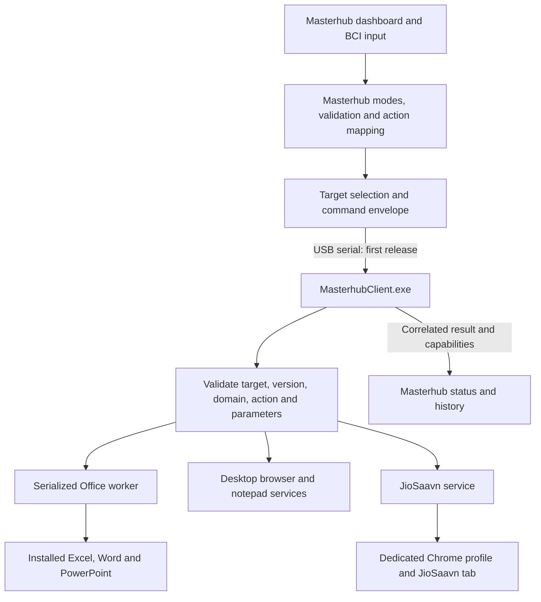

# Masterhub Office + JioSaavn integration plan

Prepared: 16 October 2026. Status: source-reviewed implementation plan; no application changes or EXE build performed.

## 1. Recommended outcome

Deliver **MasterhubClient.exe**, one Windows client containing the Python desktop automation services (including Excel, Word and PowerPoint) and desktop JioSaavn controls. Keep the existing Masterhub dashboard/server as the command and navigation authority.

Use `D:/GALATICX/synaptimesh_client` as the client baseline. Use `D:/GALATICX/15-10` as the reference for Office behavior and regression cases. Reuse the relevant JioSaavn implementation from Masterhub. Do not merge the two complete dashboards, launch two clients, or bundle Masterhub's database/server into this client.

Planning assumptions: Windows x64; an interactive signed-in user; installed desktop Office and Chrome; desktop JioSaavn is the AI/ML component requested. The Android companion remains separate. No model files or standalone AI/ML client were identified in the supplied client source inventory; this plan uses Masterhub's existing media implementation. If the AI/ML team has a separate newer implementation, compare it before starting the media phase.

One EXE means one distributed client executable. It does not mean Office, Chrome, USB drivers, music content or the Masterhub server are embedded in it. A packaged Python runtime removes the need for users to install Python.

## 2. What the source actually contains

- **15-10:** a FastAPI desktop dashboard, its own Cortex/navigation logic, UART transport, and Office/browser/notepad subplugins. The README describes application-selection and execution gestures. These descriptions are reference material, not instructions to run its launcher.
- **synaptimesh_client:** a smaller runtime with serial and WebSocket transports, a parser/router, Office/browser/notepad services, persistent AppData paths, tests and a PyInstaller spec. Its spec creates a **folder distribution**, and its release script creates a ZIP. Existing build outputs are not evidence that the proposed combined EXE works.
- **Masterhub:** mapping-driven domains and modes, local/remote dispatch, USB and MQTT command senders, JioSaavn search/play through a controlled Chrome tab, generic media-key controls, and a separate mobile JioSaavn route.
- **Office is not yet wired into Masterhub's desktop dispatch/mode menus** in the inspected files. Client-side implementation exists, but menu, command and result integration are still required.

Important evidence files:

- `synaptimesh_client/synaptimesh/main.py`: creates the router without an AI/ML handler.
- `synaptimesh_client/synaptimesh/protocol/router.py`: an absent AI/ML handler returns a simulated success; MQTT is rejected.
- `synaptimesh_client/synaptimesh/protocol/parser.py`: JSON requires `command` and reads `payload`.
- `masterhub_iot_noushith/services/usb_service.py`: sends `action`, `params`, `target` and `command_id` in a Masterhub envelope.
- `synaptimesh_client/synaptimesh/transport/uart_transport.py`: generates local UART command IDs instead of carrying the sender's ID through parsing.
- `synaptimesh_client/synaptimesh/protocol/deduplicator.py`: caches by command content; rapid intentional repetitions can be suppressed.
- `synaptimesh_client/synaptimesh/handlers/desktop_handler.py`: has its own selection state and context-dependent combined gestures.
- `masterhub_iot_noushith/actions/ai_ml/jiosaavn.py`: search/play depends on private helpers from `actions/desktop/youtube.py`.

## 3. Architecture and ownership



**Masterhub owns:** BCI timing/combination interpretation, menu navigation, target selection, command IDs, user-facing results and history.

**Client owns:** execution on its PC, application/document handles, safe saves/closes, browser session state, transport reconnects and execution results. It receives explicit actions, not ambiguous raw navigation gestures.

**Python domain team owns:** Office behavior, client integration, COM lifecycle and packaging. **AI/ML team owns:** JioSaavn command behavior, browser selectors and playback checks. **Masterhub/IoT team owns:** mappings, transport contract, target readiness and result presentation. **Joint QA owns:** real Windows acceptance and regression evidence. These are proposed responsibilities, not assignments already sent to the teams.

Keep legacy client commands at the parser boundary only where compatibility tests require them. Do not introduce another gesture engine in the combined EXE.

## 4. Resolve blockers before packaging

### A. Incompatible command envelopes

Adopt Masterhub's existing JSON-line envelope as the canonical contract. Add client translation from `action/params` to its internal dispatch shape, accepting `ai_ml` as the AI/ML domain. Preserve `command_id` end to end. Validate the protocol version, intended target, domain/action pairing, parameter types, lengths and permitted save locations. Explicit domain labels must not bypass the action allowlist.

Example proposed Office request:

```json
{"protocol":"masterhub","version":"1.0","message_type":"command","command_id":"cmd_office_001","target":"PC_001","domain":"desktop","action":"office_excel_open","params":{}}
```

Example media request using an existing Masterhub action:

```json
{"protocol":"masterhub","version":"1.0","message_type":"command","command_id":"cmd_music_001","target":"PC_001","domain":"ai_ml","action":"search_jiosaavn","params":{"query":"requested song"}}
```

Proposed result fields: `protocol`, `version`, `message_type: command_result`, unchanged `command_id`, `source`, `domain`, `action`, `status`, `details`, and structured `error` on failure. Define accepted/running/succeeded/failed/timed_out/needs_user_action states in the contract; adapt existing status names once at the boundary. Sending bytes is **published**, not proof of execution. Update Masterhub's history/UI to display execution completion separately.

Retry with the same ID; intentionally repeated actions receive new IDs. Deduplicate by sender/target and command ID, with a bounded cache and in-flight protection. Reject a reused ID with different content. Do not automatically retry an uncertain non-idempotent save/edit/delete after a client crash; report unknown completion and require reconciliation.

### B. Transport mismatch

For the first integration, reuse USB serial end to end. Masterhub defaults to **115200 baud**, while the supplied client defaults to **9600**; configure the same value at both ends and document the wiring/bridge arrangement. Two PCs need an actual supported serial link; two processes cannot simply open the same COM port simultaneously.

Register/select a USB desktop target with an ID matching the client's configured identity. Add a capability/status handshake that reports executable version, supported actions, Office availability and browser readiness. A connected cable alone must not make unavailable Office features look ready.

For same-PC use, retain Masterhub's local dispatch and reuse the Office service through a local adapter; do not start a competing serial listener for that path. Both local and remote execution must share the same action semantics.

If wireless PC control is required, make MQTT a separate milestone: add client authentication, target-scoped topics, heartbeat, command/result correlation and reconnect tests against Masterhub's existing PC-agent contract. Do not register this UART-only client as MQTT-ready. The client's raw WebSocket support is not proof of compatibility with a Masterhub endpoint; defer WebSocket integration until its server contract is explicitly implemented and tested.

### C. False AI/ML success and incomplete media semantics

Wire a real AI/ML handler in `synaptimesh/main.py`. Return unsupported/error if it is unavailable. Normalize `success: false` and service error dictionaries correctly; never convert an error dictionary into a successful acknowledgement.

Port JioSaavn's browser automation and only its required helpers into the client. Do not import Masterhub's entire AI/ML handler: it imports server device registration, MQTT, USB and logging services. Move the reused browser helper to a small shared browser module only where needed by both media services.

Use one dedicated persistent Chrome profile and one owned JioSaavn tab. Masterhub's current open action and search action use different browser paths; unify them in the client. The existing search helper uses `requests` and `websocket-client`; these are distinct from the client's existing `websockets` dependency and must be included if retaining this implementation.

Required media scope: open, search-and-play, play/pause, next, previous, volume up/down, mute and close the owned tab. Do not claim album search support from the current stub. Prefer tab-targeted playback controls; generic OS media keys can control another application. If system volume is retained, label it clearly as system volume. Keep toggle separate from explicit play/pause so retrying a pause cannot resume music.

Report missing login, no results, blocked playback, browser loss and selector failure truthfully. Verify playback where observable; issuing a keypress is not playback confirmation.

### D. Navigation and document safety

Preserve Masterhub's current gestures. Its desktop Left already selects Notepad; the supplied desktop README assigns Left to Office. Do not silently replace Notepad. Add an Office tile and a proposed unused desktop-menu combination such as Left+Right only after checking the complete gesture map and combination timing. Keep selection non-launching.

Proposed menu: Python/Desktop → Microsoft Office → Excel / PowerPoint / Word → actions. Add Office and three application modes to the existing mapping files. Use Masterhub's existing Back/Home behavior. Never send `PUSH_RIGHT` to the Office handler for navigation: that combination can mean edit in the client. Send explicit edit, delete, close or navigation actions.

Reuse the supplied Excel create/populate/save, PowerPoint create/add/edit/save, and Word create/write/edit/save operations. Compare the two source implementations and their regression tests before choosing each behavior; copying the large desktop UI is unnecessary.

Existing Office code has some unsaved-change guards, but also close paths using `SaveChanges=0`, suppressed alerts and swallowed save errors. Ensure a failed save prevents close. Default Back/Home to navigation without discarding documents. Explicit close must report unsaved work and allow save, cancel or explicit discard. Limit operations to client-owned documents and application instances; never close all user documents or kill all Office processes.

Run Office calls on one dedicated worker thread with balanced COM initialization/cleanup and owned object lifetime. Keep serial receive/health responsive while a document operation runs. Use a bounded queue and busy responses. A timeout must not pretend that a still-running COM operation was cancelled or immediately retry it. If real-machine tests show uninterruptible hangs, isolate Office in a worker process launched by the same EXE; do not build that complexity before it is needed.

## 5. Implementation reach

Masterhub files to change or extend:

- `mappings/command_map.json`: explicit Office actions and their desktop routes.
- `mappings/mode_map.json`, `gesture_map.json`, `workflow_map.json`, `desktop_map.json`: Office hierarchy, labels, parameters and gestures; preserve current desktop/media/mobile commands.
- `actions/desktop/handler.py`: Office dispatch and local service adapter; preserve remote target routing.
- `actions/ai_ml/handler.py`: consistent media semantics and truthful errors where shared behavior changes.
- `services/usb_service.py`: handshake/result parsing, preserved IDs and completion status.
- `services/workflow_service.py`, `core/devices.py`: capability-based readiness where required.
- `static/masterhub.js` and applicable templates: Office navigation, required parameters and execution status using the existing UI structure.
- `services/event_store.py` and history consumers: change only if the proposed result states cannot be represented by existing event fields.
- `core/input_processor.py`, `core/state.py`, `core/engine.py`: inspect callers and navigation assumptions; modify only if mapping additions reveal hardcoded limitations.
- Relevant workflow, BCI, media and hardware tests plus new Office/protocol contract fixtures.

Client files to change or extend:

- `synaptimesh/main.py`: register both handlers and control startup/shutdown.
- `protocol/parser.py`, `models.py`, `router.py`, `deduplicator.py`: envelope compatibility, validation, aliases, ID-based execution and honest results.
- `transport/uart_transport.py`: retain inbound IDs, bound input size and return compatible results; preserve reconnect behavior.
- `handlers/desktop_handler.py`, `services/office_service.py`, `office_content.py`: explicit Office actions, document ownership and save/close safety.
- New `handlers/aiml_handler.py` and `services/jiosaavn_service.py`: client-only media dispatch and execution.
- Existing browser helpers/configuration: persistent profile paths and targeted session cleanup; share only the functionality actually required.
- `config/config.py`, `config.sample.json`: identity, agreed baud rate, persistent data and approved output location.
- `requirements.txt`, development/build requirements, `synaptimesh.spec`, `build_release.py`: tested dependency versions and single-file packaging.
- Existing parser/router/Office/UART/config tests plus JioSaavn and frozen-runtime tests. Update compatibility matrix and migration instructions to match verified support.

Work in a controlled copy of the supplied client under the project or a dedicated repository; preserve the supplied folders as reference snapshots. Record source versions/hashes. Do not run the supplied cleanup build script against the only copy of existing release artifacts.

## 6. Build a genuine single executable

1. Establish a clean Windows x64 build environment and select a Python version supported by the full tested dependency set. Pin the versions that pass; current `>=` requirements are not a reproducible release lock.
2. Get the combined source client passing contract and mocked service tests. Build a temporary one-folder package first to diagnose missing imports/resources.
3. Correct the existing spec's exclusions. In particular, it excludes Pillow/PIL while including PyAutoGUI; prove the chosen input path works before retaining that exclusion. Keep unnecessary ML/server frameworks out of the client; the domain label alone does not require Torch or TensorFlow.
4. Include required pywin32/COM modules, browser automation helpers and any runtime resources. Verify Selenium Manager/driver availability if existing browser services remain enabled. Do not ship personal browser profiles, credentials, logs, `.env` files or test data.
5. Create the final one-file spec: collect binaries and data into EXE rather than the current `EXE(exclude_binaries=True)` plus `COLLECT` folder pattern. Preserve the working one-folder spec as a diagnostic build if useful.
6. Keep mutable configuration, logs, profiles and COM-generated caches in `%LOCALAPPDATA%/SynaptiMesh`; use an explicit user document output directory. JioSaavn's source-relative `.runtime/youtube-chrome` path must be replaced for the frozen client. Never store persistent data in PyInstaller's temporary extraction directory.
7. Build `MasterhubClient.exe` from the spec. Example future command, after the spec is implemented: `python -m PyInstaller --clean --noconfirm MasterhubClient.spec`. The current spec does not yet satisfy this step.
8. Test the single EXE on a clean Windows PC without Python installed. Verify first-run config creation, browser/Office dependencies, repeated launch protection, restart, paths containing spaces/non-ASCII characters and a standard non-admin account.
9. Record executable version, SHA-256, exact dependency lock and test report. Sign the distributable if a signing certificate is available. Measure startup time and actual size rather than promising the supplied README's under-100-MB claim for the new combined build.

Deliverables: final single client EXE; safe example configuration; quick-start/prerequisite guide; command contract; test evidence; checksums and reproducible source/build instructions. Runtime data will still be created outside the EXE.

PyInstaller documents that one-file builds extract bundled components on startup: [operating mode](https://pyinstaller.org/en/stable/operating-mode.html). Office automation should run in the user's interactive Windows session, not be silently converted into an unattended Windows service: [Microsoft automation considerations](https://learn.microsoft.com/en-us/office/client-developer/integration/considerations-unattended-automation-office-microsoft-365-for-unattended-rpa).

## 7. Delivery sequence and estimated effort

These are planning estimates in engineering days, not measured completion times or commitments. Integration defects, Office variants and unavailable hardware can extend them.

1. **Contract and baseline — 1–2 days.** Freeze sources, compare Office behavior, define actions/results/gestures, run safe baseline tests, confirm serial topology. Exit: agreed contract and representative fixtures.
2. **Masterhub Office integration — 2–3 days.** Add modes/menu/actions and local/remote adapters; implement document-safety fixes. Exit: Excel, Word and PowerPoint flows pass against disposable documents.
3. **Client protocol and real JioSaavn — 2–3 days.** Fix parser/results/IDs, register media execution, resolve browser profile and ownership. Exit: both domains execute through the same source client and report honest results.
4. **End-to-end serial and recovery — 1–2 days.** Integrate capability discovery, correlation, reconnect and duplicate handling. Exit: real Masterhub → client → app → result round trips.
5. **Packaging and acceptance — 2–3 days.** Build and verify one-folder then one-file, run clean-machine checks and document the release. Exit: versioned EXE and evidence.

Expected base effort: **8–13 engineering days**, roughly 2–3 working weeks for a sequential implementation with timely hardware access. Team overlap can reduce elapsed time but not remove contract and acceptance dependencies. MQTT/network integration, a separate AI/ML codebase, or a redesigned dashboard are additional scope.

## 8. Acceptance criteria

- Launching the client opens no Office app, browser or music automatically; status/capability reporting is allowed.
- One EXE handles Office and JioSaavn; no second client and no installed Python are required.
- Excel creates a workbook, populates the requested sheets, saves, and reopens correctly. Word creates/edits/saves a document and reopens it. PowerPoint creates/adds/edits/saves a presentation and reopens it. Use disposable fixtures and compare expected content.
- Selecting an Office menu item does not launch an application prematurely. Back/Home never becomes an edit/delete operation and never silently loses work.
- Save failure, unsaved close, missing Office, locked/protected files and access denial produce actionable failures without closing unrelated documents.
- JioSaavn opens, searches and starts the selected song; next/previous/play/pause act on the intended session. Missing login/no results/audio block fail honestly. System-volume behavior is explicitly identified.
- Masterhub's remote command ID matches the returned execution result. Cable loss does not produce success. Reconnect does not replay an already completed destructive action.
- Same-ID retry executes once; distinct-ID repeated next/volume commands both execute. Simultaneous transport delivery cannot execute the same ID twice.
- Wrong target, unknown version/action/domain, malformed JSON, oversized frames and invalid parameters are rejected. No network control is exposed without authentication and target authorization.
- Long browser/Office operations keep the transport responsive; uncertain timeouts do not trigger unsafe retries.
- Existing Chrome, YouTube, Gmail, Notepad, mobile JioSaavn, IoT and mobility routing retain their existing behavior in relevant regression tests.
- Final one-file build passes on a clean Windows machine without Python, persists profiles/config after restart, and contains no developer secrets or profiles.

Run only selected mocked/contract tests first. Masterhub's README explicitly notes that parts of the test tooling interact with real applications or hardware; inspect test fixtures before running broad suites. Real Office/browser/UART acceptance is mandatory before claiming release readiness.

## 9. Decisions to confirm during kickoff

Recommended defaults are already used above, so planning can proceed:

- Deployment: separate Masterhub and a remote Windows client; same-PC local mode stays supported through shared action semantics.
- First transport: existing USB serial at an agreed baud rate. Confirm actual cable/bridge hardware before implementation.
- Media source: current Masterhub desktop JioSaavn. Obtain a separate AI/ML team's source only if it is the intended authoritative version.
- Product format: one portable client EXE; an installer is optional later, not a substitute for the requested combined runtime.
- Office scope: Excel, Word and PowerPoint first. Existing Gmail automation is not Outlook automation; Outlook-specific work requires separate scope.
- Navigation: retain current Masterhub gestures, add Office access without displacing Notepad, and default Back/Home to non-destructive navigation.

## 10. Verification limits of this plan

The plan is based on source inspection and official packaging/Office guidance. Supplied README claims and regression reports were treated as claims, not verified test outcomes. No Office/browser automation, hardware connection, broad test suite or supplied EXE was executed. No EXE has been produced in this planning task. The principal remaining risks are protocol incompatibility, false completion reporting, Office data loss on unsafe close paths, browser-site changes and machine-specific frozen-runtime behavior.
